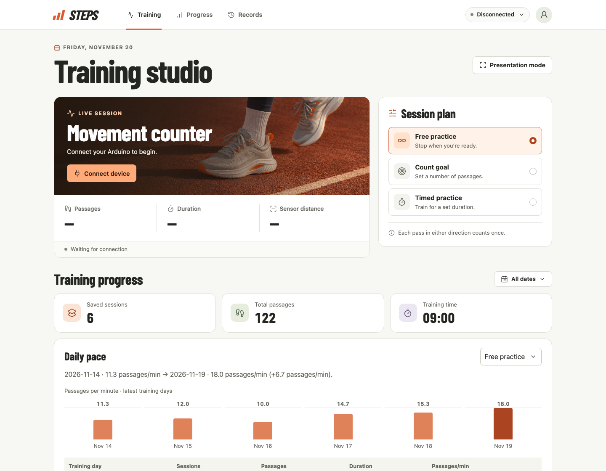
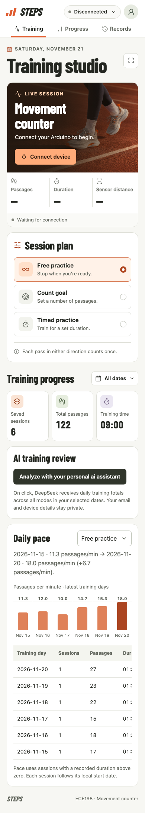

# ECE198 Motion Counter

STEPS counts each time an object passes an ultrasonic sensor. An HC-SR04 measures distance, an Arduino UNO R4 Minima counts passages and saves session summaries, and a browser dashboard shows live readings and training history. You can use the hosted training studio or run the demo locally on a Mac.

## Use the hosted training studio

Open the [STEPS training studio](https://sagacopilot.com/) and sign in or create an account with an email address and password. You can use **Progress** to review training by date and **Records** to export sessions as a CSV. The hosted site stores accounts and sessions in Cloudflare D1. The local demo uses its own SQLite database.

For live training, connect the Arduino to the computer running a desktop browser with Web Serial support, such as Chrome or Edge. Close any local demo service or serial monitor using the port. Click **Connect device**, select **Choose USB device** in the **Device setup** panel, and choose your board. Select a training mode and click **Start session**.

Keep the tab open until the board confirms the save and the session syncs to your account. If the network drops after the browser receives the board’s save confirmation, the browser retries the upload. You can review your history on another device without connecting an Arduino.

## Training studio screenshots

Both views show the same six demo sessions. Select either screenshot to see it at full size.

<p>
  <a href="docs/screenshots/training-studio-desktop.png"></a>
  <a href="docs/screenshots/training-studio-mobile.png"></a>
</p>

## Quick start for a local demo

Once you have [uploaded the firmware](#2-upload-the-firmware), use these steps for each demo.

1. Wire the sensor and connect the Arduino to the Mac with a USB data cable.
2. Run `./start-demo.command` from the project directory and leave the terminal open. The script starts the local service, opens the dashboard, and tries to connect automatically if it detects exactly one Arduino.
3. On your first visit, select **Create account** and enter an email address and password. Use the same account on subsequent visits. Once the board is connected, choose a mode under **Session plan** and click **Start session**.
4. In free practice, click **Stop & save** when you finish. Count and time goals stop automatically when the computer receives a reading that meets the target. You can also stop early. Open **Progress** for daily trends or **Records** for individual sessions.

The uploaded firmware runs whenever the board receives USB power. For routine demos, the dashboard buttons start and stop counting. You can leave the Arduino IDE closed.

**What counts as one passage?** Moving down through the detection zone counts once. After the zone clears, moving back up counts again. That down-and-up movement produces two sensor passages. A prescribed exercise may use a different definition of one repetition.

## Training modes and daily progress

| Training mode | When the session ends | What you can compare |
| --- | --- | --- |
| Free practice | Click **Stop & save** | Passage count over a duration of your choice |
| Count goal | The board reports that the passage target has been reached | Time and pace for the same passage target |
| Timed practice | The board reports that the time limit has been reached | Passage count for the same time limit |

All three modes use the same FW3 Passage firmware. Keep the USB connection and the dashboard active during training. For a local demo, keep the local service running as well. The computer sends `STOP` when the board reports the target count or duration. The saved summary uses the board’s final readings, including when you stop early. Sampling and serial delays can put the final count or time slightly above the target.

**Progress** groups sessions by the computer’s local date when each session started. It shows session count, total passages, training time, and, for targeted training, how many sessions met the goal. Open **All dates** to set **From** and **To**. Both endpoints are inclusive. Leave both fields empty to see all dates. The same date range applies to the session list and CSV export.

Under **Daily pace**, select a mode and target to compare your first day with a valid pace against your latest training day in the selected range. Daily pace is the total number of passages divided by total minutes across sessions with a recorded duration above zero. Zero-second sessions still contribute to session and passage totals.

For example, if you complete one 60-second timed session on each of two days and record 8 and 10 passages, your pace changes from 8 to 10 passages per minute, an increase of 2. Use the same movement and sensor position when comparing days. These readings describe participation and pace. Assessing movement quality, overall motor ability, or rehabilitation outcomes requires additional evidence.

### One-click AI training review

On the hosted site, open **Progress**, choose a date range, and click **Analyze with DeepSeek**. The review covers all training modes in that range. The mode and target selector under **Daily pace** applies only to that chart.

The Worker calculates daily passages, total training time, and weighted passages per minute from the signed-in account’s records. The results show the first and last training days and their measured differences. This table still works if DeepSeek is unavailable or the API account runs out of credit. DeepSeek explains the changes, suggests one next session within the user’s existing exercise plan, and offers a practical tip for making the next comparison useful. A single training day establishes a baseline. If a day has no recorded duration, its pace and any change that depends on it appear as a dash.

Analysis runs only when someone presses the button. DeepSeek receives training dates, daily session counts by mode, passages, duration, and pace. Account IDs, email addresses, device details, and individual session records stay with STEPS. Every training day in the range contributes. For ranges above 90 training days, the first and latest 89 days are sent individually and the intervening days are grouped by calendar month, with weighted pace calculated from their timed passages and seconds. Reviews are displayed in the browser and are not saved to D1. Changing dates or saving a new session clears the previous review.

The local Python demo keeps its records offline. To use AI analysis, sign in to the hosted studio with an account that has saved training there.

## Get the project

Clone the [GitHub repository](https://github.com/Ltcc0/ece198-motion-counter) and enter the project directory.

```sh
git clone https://github.com/Ltcc0/ece198-motion-counter.git
cd ece198-motion-counter
```

If you already have a copy of the project folder, open that folder in Terminal and continue with setup.

## 1. Prepare the hardware

You will need an Arduino UNO R4 Minima, an HC-SR04 ultrasonic sensor, a breadboard, jumper wires, a data-capable USB-C cable, and a Mac. The local demo uses the following software.

- **Arduino IDE 2** to upload the firmware the first time and after any firmware changes.
- **Python 3.9 or later** to run the local web server and USB serial connection. Check your version with `python3 --version`. Install Python from the [official macOS downloads](https://www.python.org/downloads/macos/) if needed.
- **A web browser** to open the dashboard. The frontend runs directly in the browser without Node.js, npm, or a build step.

Installing the board package and Python dependencies for the first time requires internet access. Once set up, the local demo can run offline.

Disconnect USB power before wiring. Match the printed pin labels on the sensor and board.

| HC-SR04 pin | Arduino UNO R4 Minima pin |
| --- | --- |
| VCC | 5V |
| TRIG | 9 |
| ECHO | 10 |
| GND | GND |

Place each of the four sensor pins in a separate breadboard row. Put each jumper in a hole electrically connected to its corresponding pin. Check both ends before reconnecting USB. The firmware sets `USE_POT = false`, so you can leave the potentiometer disconnected. See the [wiring diagram](docs/wiring.svg).

## 2. Upload the firmware

1. Open [ExerciseCounter.ino](firmware/ExerciseCounter/ExerciseCounter.ino) in the Arduino IDE.
2. Open **Boards Manager**, search for `UNO R4`, and install **Arduino UNO R4 Boards**.
3. Select **Arduino UNO R4 Minima** and the board’s USB port. On a Mac, the port usually appears as `/dev/cu.usbmodem...`. Bluetooth and debug-console entries are unrelated to the board.
4. Click **Upload** and wait for it to finish. **Verify** only compiles the sketch. For help locating the menus, see Arduino’s [board and port selection guide](https://support.arduino.cc/hc/en-us/articles/4406856349970-Select-board-and-port-in-Arduino-IDE).
5. Close the Arduino IDE’s **Serial Monitor** and **Serial Plotter** before opening the dashboard. Only one application can use the serial port at a time.

The firmware starts automatically on the board. Click **Start session** in the dashboard to start counting. You only need to upload again when the firmware changes.

## 3. Start the local dashboard

Open Terminal and change to the project directory. On a Mac, you can type `cd` followed by a space, drag the `ece198-motion-counter` folder from Finder into Terminal, and press Return.

```sh
./start-demo.command
```

The launcher prepares the project’s `.venv`, installs its dependencies, and opens the dashboard. **Leave the terminal running.** If the browser does not open automatically, visit the [local dashboard](http://127.0.0.1:8765).

The local service tries to connect automatically when it detects a single Arduino. If it needs your input, open **Device setup**, select the Arduino’s USB port, and click **Connect device**. Confirm that the status is updating before starting a session. The Python service serves the dashboard and handles USB communication.

The dashboard shows the count, elapsed time, sensor distance, and current detection state. Open **Records** to refresh the session history or select **Export CSV**.

If Terminal reports a permission error when launching the script, run `chmod +x start-demo.command` in the project directory and try again.

### Manual startup

To start the local service manually, create the environment and install dependencies once from the project root.

```sh
python3 -m venv .venv
.venv/bin/python -m pip install -r requirements.txt
```

For each demo, start the server and open the [local dashboard](http://127.0.0.1:8765).

```sh
.venv/bin/python backend/server.py
```

## 4. Demonstrate a passage

Mount the sensor to one side so the object crosses in front of it as it moves up or down. Start with a large, flat object and keep the sensor still.

1. Click **Start session**. Move the object out of the detection zone and wait for **Ready for your next pass** (firmware state `ARMED`).
2. Move the object slowly through the zone **2–25 cm** in front of the sensor. Three consecutive valid readings in that range register one passage.
3. Hold the object in place. The dashboard shows **Pass counted · move fully away** (firmware state `OCCUPIED`), and the count stays the same.
4. Move the object completely out of the beam or at least **35 cm** away. Keep the zone clear for at least **0.3 seconds** and wait for **Ready for your next pass** before crossing again.
5. Click **Stop & save** and wait for the board to confirm the save. Open **Records** to review the session, refresh the history, or export a CSV.

Allow the zone to clear before each return pass. A fast sweep can produce fewer than three samples, and reversing before the sensor rearms produces only one count. Readings between the entry and clear thresholds do not complete either condition. Readings below 2 cm are ignored for both entry and clearance.

A sustained absence of echoes can indicate an empty detection zone. The dashboard then shows **Clear** in the distance field, corresponding to `NO_TARGET` or `NO_ECHO` in the serial output. Missing echoes alone do not add to the count. If a stationary object repeatedly loses and regains its echo, however, it can register as another passage. Check the connection and sensor placement if USB disconnects, the dashboard reports a connection error, or an object held in front of the sensor consistently goes undetected.

At the end of the demo, click **Stop & save** and confirm the save before pressing **Control+C** in the terminal to stop the local server.

## 5. Data storage and project scope

- **Board storage.** EEPROM holds the most recent **16 valid session summaries**, each with a session ID, count, and duration in seconds. New records overwrite the oldest when the log is full.
- **Power loss.** The board saves a summary when `STOP` succeeds. A session still in progress at power loss cannot be recovered. Record checks detect some interrupted writes, but power loss during a write can still leave a summary incomplete.
- **Older board records.** The board log has no counting-mode field. When no reliable mode was saved elsewhere, the dashboard marks it as unrecorded. Older firmware may have counted an approach and return as one cycle, so check the counting rule before comparing older records with passages.
- **Local accounts and history.** The local SQLite database at `runtime/sessions.sqlite3` stores accounts, training modes, targets, start and save times, counts, and durations. Registration takes an email and password without email verification. Passwords are stored as salted hashes. Select **Sign out** in the account menu to end your login. Sign back in to see your history. Git ignores the local database.
- **Legacy data and reconnection.** At startup, the local service imports valid entries from `runtime/sessions.json` and keeps the original file. Board history has no user identity or calendar date. Legacy nickname profiles and their records stay in the local database. Registering an email does not claim a matching nickname profile. Each personal dashboard shows sessions assigned to that account. After a USB disconnect or local service shutdown, the board can return only summaries it had already saved.

The original STEPS proposal focused on prompting and logging participation in home movement after the program ended. Clinicians would determine suitable exercises and participants. This classroom bench prototype uses a dashboard for the controls originally proposed as an OLED and physical buttons. It uses passage counting for the demo, fixed thresholds in the firmware, and a disabled potentiometer by default. Automatic calibration is not implemented. The prototype does not assess clinical suitability, movement quality, or treatment effectiveness.

## Project files

| Path | Purpose |
| --- | --- |
| `firmware/ExerciseCounter/` | Sketch to upload to the UNO R4 Minima |
| `frontend/` | Browser dashboard, served without a build step |
| `backend/server.py` | Local web server and USB serial connection |
| `backend/training.py` | SQLite storage for profiles and sessions, plus daily training summaries |
| `start-demo.command` | Mac launcher |
| `scripts/flash.sh` | Optional Arduino CLI upload script. Use the IDE for the guided first upload. |
| `scripts/test-firmware.sh` | Computer-based simulation tests for the firmware logic. Test the physical sensor separately. |
| [Demo guide](docs/DEMO_GUIDE.md) | Demo walkthrough and troubleshooting |
| [Serial protocol](docs/SERIAL_PROTOCOL.md) | Firmware serial commands and output formats |

## Cloudflare deployment

[wrangler.jsonc](wrangler.jsonc) defines the frontend assets, Worker entry point, and D1 binding. To deploy a new instance, create a D1 database and set its binding ID in the configuration. Then apply the remote migrations.

```sh
npx wrangler d1 migrations apply ece198-motion-training --remote
```

Set a random value for the Worker secret `PASSWORD_PEPPER`, then run `npx wrangler deploy`. Keep the same secret when updating an existing instance so existing accounts can continue to sign in.

### Enable DeepSeek

Create an API key in the [DeepSeek Platform](https://platform.deepseek.com/api_keys) with an account that has available API credit. From the repository root, run the following command and paste the key at Wrangler’s hidden prompt.

```sh
npx wrangler secret put ai-analysis
```

You can also set `ai-analysis` as a **Secret** in the Worker’s **Settings → Variables and Secrets**. The value belongs only in the Worker secret store. The browser calls the authenticated `POST /api/progress/analysis` endpoint. The Worker uses the [DeepSeek chat API](https://api-docs.deepseek.com/) with `deepseek-flash`. Each successful review uses the operator’s DeepSeek API credit.

When the secret is missing, the hosted page shows that AI analysis is awaiting activation. Empty date ranges skip the provider call. The Worker limits analysis to four requests per minute per account and per source IP at each Cloudflare location. Provider credential, billing, capacity, and timeout errors appear in the review panel without exposing provider responses or the key.

Run the AI endpoint regression tests with Node.js 24 or later. They use an isolated SQLite database and a simulated provider.

```sh
node --test tests/training-analysis.test.mjs
```
